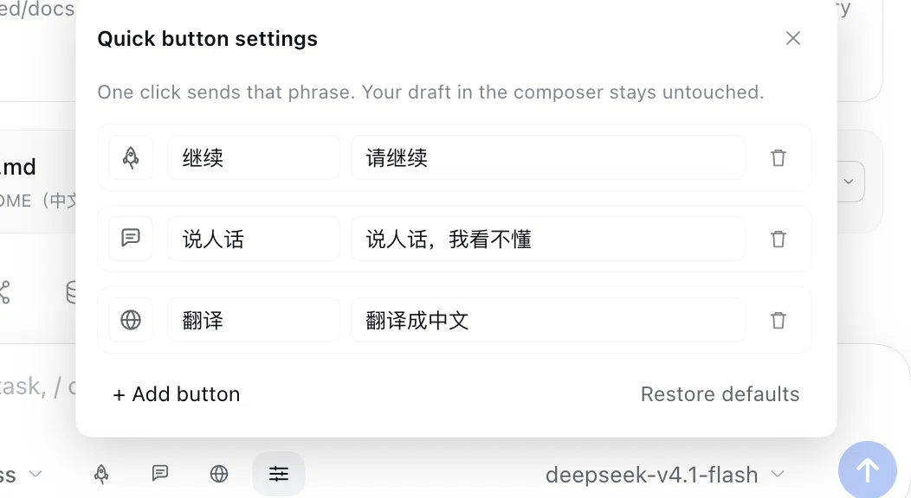

# dsh-quick-resume

> A row of quick-phrase buttons in the DSH (DeepSeek Harness) web composer: one click sends "keep going", "speak plainly", "translate to Chinese", or any phrase you define — so a stalled agent keeps working without you retyping, and without touching your draft.

[](https://www.npmjs.com/package/dsh-plugin-quick-resume)
[](LICENSE)
[](#compatibility)

## Why

A flaky network, a model timeout, or a pending approval can leave an agent stopped halfway. To nudge it, you go back to the composer and type "please continue" — dozens of times a day.

This plugin turns that into a button, and gives you a row for the other phrases you keep typing:

- **Non-intrusive**: it sends through the host's public `conversation.send()`, exactly like pressing Enter; nothing is written into the editor, and your half-written draft stays untouched.
- **Per conversation**: the row lives in the session scope, so switching conversations never sends into the wrong one.
- **Yours to shape**: button count, labels, icons, and the phrases themselves are editable; the layout stays on your machine.

## Features

- A quick-phrase row in the composer's bottom tool row, three buttons by default, **one set per conversation**
- Settings popover: edit labels, sent phrases, and icons; add/remove buttons (up to 8); restore defaults
- Icon picker: 10 single-color line icons — pick an icon, no text dropdown
- Send feedback: spinner → green check; failures turn red and shake, plus a toast above the composer
- Follows the host theme: only `--dsw-alias-*` tokens, works in light and dark
- Narrow-screen friendly: labels collapse to icon-only below 660px of composer width
- Local only: no network calls, no telemetry, layout stored in `localStorage`

## Preview



## Install

### Plugin market (recommended)

Open DSH → Settings → Plugins → **Add plugin**, search for **`dsh-plugin-quick-resume`** (the npm package name), install, then refresh the page.

> The market index is rebuilt nightly, so a brand-new release may take a day to appear.

### Manual

```bash
# 1. Add the package to your profile
dsh plugin --profile web add dsh-plugin-quick-resume
```

```jsonc
// 2. Append it to dsh.profile.bundles in ~/.dsh/profiles/web/package.json
"dsh": { "profile": { "bundles": [ /* ... */, "dsh-plugin-quick-resume" ] } }
```

```bash
# 3. Restart
dsh web
```

From source:

```bash
git clone https://github.com/yuna78/dsh-quick-resume.git
cd dsh-quick-resume
dsh plugin --profile web add link:$PWD
# add dsh-plugin-quick-resume to dsh.profile.bundles the same way, then restart
```

## Usage

The three default buttons:

| Icon | Label | Sends |
| --- | --- | --- |
| Rocket | 继续 | `请继续` |
| Speech bubble | 说人话 | `说人话，我看不懂` |
| Globe | 翻译 | `翻译成中文` |

Click the **gear** at the end of the row to open the settings popover above the buttons (click outside or press `Esc` to close):

- **Icon**: click the icon chip, pick from 10 single-color glyphs
- **Button text**: the short label on the pill; leave empty for icon-only
- **Message to send**: the exact text one click sends, any content
- **Remove** / **+ Add button** (max 8) / **Restore defaults**

Changes apply and persist immediately — no restart or refresh.

Stored in `localStorage` under `dsh.quick-resume.buttons.v1` (per browser and origin, never uploaded).

## How it works

- **Mount point**: `conversation.input.left` — the composer card's bottom tool row, right after the `+`, permission, and plan controls.
- **Sending**: resolves the session-scoped `conversation` service and calls `conversation.send(text)`, which is `session.prompt([{ type: 'text', text }], 'queue')` — an ordinary user message that wakes an idle agent immediately and queues while one is running.
- **Session addressing**: the local `sessionId` is resolved to `sessions.scope(id)` at click time, never cached across conversations.
- **No host tools**: purely a UI action, only triggered by the user; nothing new is exposed to the model.

## Compatibility

- DSH `>= 0.2.1-rc.2 < 0.3.0`, web client only (`dsh.web`)
- Renders only when a conversation is open (not on the new-session hero screen)
- The host hides the whole bottom tool row while voice input / activity is expanded; the buttons disappear for those moments and come back — host behavior, not a crash

## Project layout

| File | Purpose |
| --- | --- |
| `package.json` | bundle manifest: `dsh.bundle.patch` (installable) + `dsh.client` (web half) |
| `cordis.patch.yml` | inserts the `quick-resume` row into a profile |
| `index.js` | host half: empty `apply()` so the bundle is a normal, listable plugin |
| `client.js` | everything: locale dictionaries, row, settings popover, localStorage, sending |
| `locale/zh.json`, `locale/en.json` | market card title and description |
| `icon.svg` | plugin icon (the `icon` field read by the 36px plugin card) |
| `docs/screenshots/` | README screenshots |
| `verify/smoke.mjs` | zero-dependency checks: manifest contract, files, syntax, locales, icon, patch |
| `LICENSE` / `CHANGELOG.md` | MIT license and version history |

## Development

Pure client-side bundle, no build step. The host hot-reloads client modules (`client-hmr` polls the bundle file every 500ms), so editing `client.js` and refreshing the page is enough.

```bash
node verify/smoke.mjs   # manifest + syntax + icon + patch checks (also runs on npm publish)
```

Factory defaults live in `client.js`:

- `DEFAULT_BUTTONS` — `icon` / `label` / `phrase` of the shipped three
- `MAX_BUTTONS` — row limit (8)
- `GLYPHS` + `ICON_NAMES` — single-color path set; add a name to expose it in the picker

## Privacy

- No network requests, no telemetry, no reading of conversation content
- The only persisted data is the button layout in local `localStorage`
- All sent phrases are authored by you; the plugin ships no tracking

## Contributing

Issues and PRs are welcome. Describe the use case first; for interaction changes a screenshot or short recording makes review much faster.

## License

[MIT](LICENSE)
