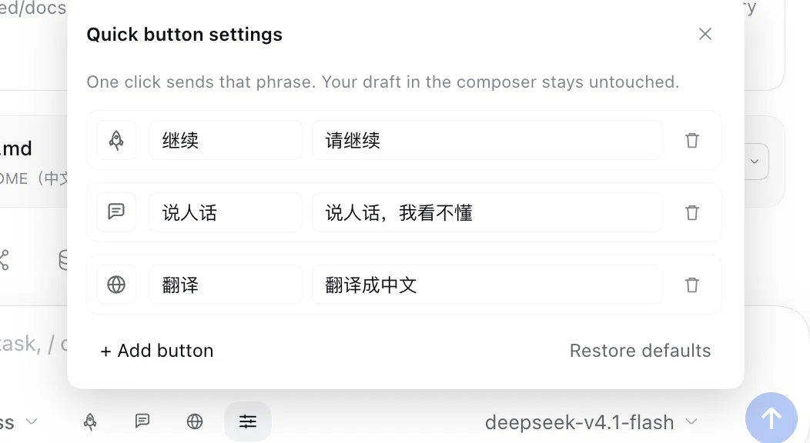

# dsh-quick-resume

> 给 DSH（DeepSeek Harness）Web 端的输入框底栏塞一排快捷语按钮：点一下就把「请继续 / 说人话，我看不懂 / 翻译成中文」这类话发出去，把卡住的 agent 一键叫醒，还不用碰你写了一半的草稿。

[](https://www.npmjs.com/package/dsh-plugin-quick-resume)
[](LICENSE)
[](#兼容性)

## 为什么做它

网络抖一下、模型超时、审批卡住……agent 常常就停在半路上。要让它继续，你得回到输入框、一个字一个字敲「请继续」，一天下来这件事能重复几十次。

这个插件把它变成输入框里的一个按钮，顺便把其他常用的催促 / 纠偏话术也做成了一排：

- **不打断你**：发送走宿主公开的 `conversation.send()`，和手动敲回车完全等价；不会往编辑器里塞文字，已经写了一半的草稿原样保留。
- **每个会话都能用**：按钮挂在会话作用域里，切换对话各自独立、不会发错窗口。
- **不够用就自己加**：按钮个数、文字、图标、发送内容都能改，配置只存在你本机。

## 功能

- 输入框底栏一排快捷语按钮，默认三颗，**每个会话各有一套**
- 自定义设置浮层：按钮文字、发送内容、图标随意改；增删按钮（最多 8 颗）、一键恢复默认
- 图标选择器：10 个单色线性图标，点图标选图标，不再有下拉框里的文字
- 发送反馈：转圈 → 绿色对勾；失败变红抖动，并在输入框上方弹出失败提示
- 跟随宿主主题：只用 `--dsw-alias-*` 主题令牌，亮色 / 暗色都不突兀
- 窄屏自适应：输入框宽度小于 660px 时自动收起按钮文字，只留图标
- 纯本地、零网络请求、零遥测：配置存在浏览器 `localStorage`

## 预览



## 安装

### 插件市场（推荐）

DSH 的「设置 → 插件 → Add plugin」里搜索 **`dsh-plugin-quick-resume`**（认 npm 包名），安装后刷新页面即可。

> 市场收录由夜间构建更新，刚发布时可能当天还搜不到。

### 手动安装

```bash
# 1. 把包装进你的 profile（包名以 npm 上的为准）
dsh plugin --profile web add dsh-plugin-quick-resume
```

```jsonc
// 2. 在 ~/.dsh/profiles/web/package.json 的 dsh.profile.bundles 里追加一行
"dsh": { "profile": { "bundles": [ /* ... */, "dsh-plugin-quick-resume" ] } }
```

```bash
# 3. 重启
dsh web
```

从源码开发：

```bash
git clone https://github.com/yuna78/dsh-quick-resume.git   
cd dsh-quick-resume
dsh plugin --profile web add link:$PWD
# 同样把 dsh-plugin-quick-resume 加进 dsh.profile.bundles，再重启
```

## 使用

默认三颗按钮：

| 图标 | 文字 | 点一下发送 |
| --- | --- | --- |
| 火箭 | 继续 | `请继续` |
| 对话气泡 | 说人话 | `说人话，我看不懂` |
| 地球 | 翻译 | `翻译成中文` |

点这一排最右边的**齿轮**，会在按钮上方弹出设置浮层（点浮层外面或按 `Esc` 收起）：

- **图标**：点当前的图标方块，展开 10 个单色图标，点哪个用哪个
- **按钮文字**：显示在按钮上的短标签；留空则只显示图标
- **发送内容**：点一下真正发出去的那句话，任意文本
- **删除** / **+ 添加按钮**（上限 8 颗）/ **恢复默认**

所有改动即时生效、即时保存，不需要重启或刷新。

配置存储位置：浏览器 `localStorage` 的 `dsh.quick-resume.buttons.v1`（按浏览器 / 站点隔离，不上传）。

## 工作原理

- **挂载点**：`conversation.input.left`——输入框卡片内部底栏工具行，紧跟在 `＋`、权限、计划这些控件之后。
- **发送**：在会话作用域里取 `conversation` 服务，调用 `conversation.send(text)`；它内部是 `session.prompt([{ type: 'text', text }], 'queue')`，也就是一条普通用户消息，agent 空闲时立即唤醒、运行中则排队。
- **会话寻址**：使用本地 `sessionId` 找 `sessions.scope(id)`，点击时才解析，不在多个会话之间缓存，保证发到当前这个对话。
- **没有 Host 工具**：纯 UI 动作，只由用户点击触发，不向模型暴露任何新工具。

## 兼容性

- DSH `>= 0.2.1-rc.2 < 0.3.0`，仅 Web 端（`dsh.web`）
- 只在存在打开会话的输入框里渲染（新会话首页不显示）
- 宿主在**语音输入 / activity 展开**时会隐藏整个底栏工具行，这几秒按钮会跟着暂时消失，收起后回来——这是宿主行为，不是插件掉了

## 项目结构

| 文件 | 作用 |
| --- | --- |
| `package.json` | bundle 清单：`dsh.bundle.patch`（可安装）+ `dsh.client`（Web 前端） |
| `cordis.patch.yml` | 往 profile 插入 `quick-resume` 这一行 |
| `index.js` | Host 半边：空 `apply()`，让 bundle 成为可列出、可开关的普通插件 |
| `client.js` | 全部功能：locale 字典、按钮排、设置浮层、localStorage 存储、发送逻辑 |
| `locale/zh.json`、`locale/en.json` | 插件市场卡片上的标题与描述 |
| `icon.svg` | 插件图标（插件面板 36px 卡片读这里的 `icon` 字段） |
| `docs/screenshots/` | README 用截图 |
| `verify/smoke.mjs` | 零依赖自检：包契约、文件白名单、语法、locale、图标、patch |
| `LICENSE` / `CHANGELOG.md` | MIT 协议与版本记录 |

## 开发

插件是纯前端 bundle，没有构建步骤；宿主会热加载 client 模块（`client-hmr` 每 500ms 轮询 bundle 文件），改完 `client.js` 刷新页面即生效。

```bash
node verify/smoke.mjs   # 契约 + 语法 + 图标 + patch 自检（npm publish 前自动跑）
```

想改出厂默认值：

- 默认按钮：`client.js` 里的 `DEFAULT_BUTTONS`（`icon` / `label` / `phrase`）
- 上限：`MAX_BUTTONS`（默认 8）
- 图标库：`GLYPHS` + `ICON_NAMES`，单色描边路径，加个名字就会出现在设置面板里

## 隐私

- 不发起任何网络请求，不收集遥测，不读取对话内容
- 只把按钮配置写进本机 `localStorage`
- 发送内容完全由你填写，插件不自带任何埋点

## 贡献

欢迎提 issue / PR。改动前请说明使用场景；涉及交互变化时附一张截图或录屏会更容易对齐。

## License

[MIT](LICENSE)
